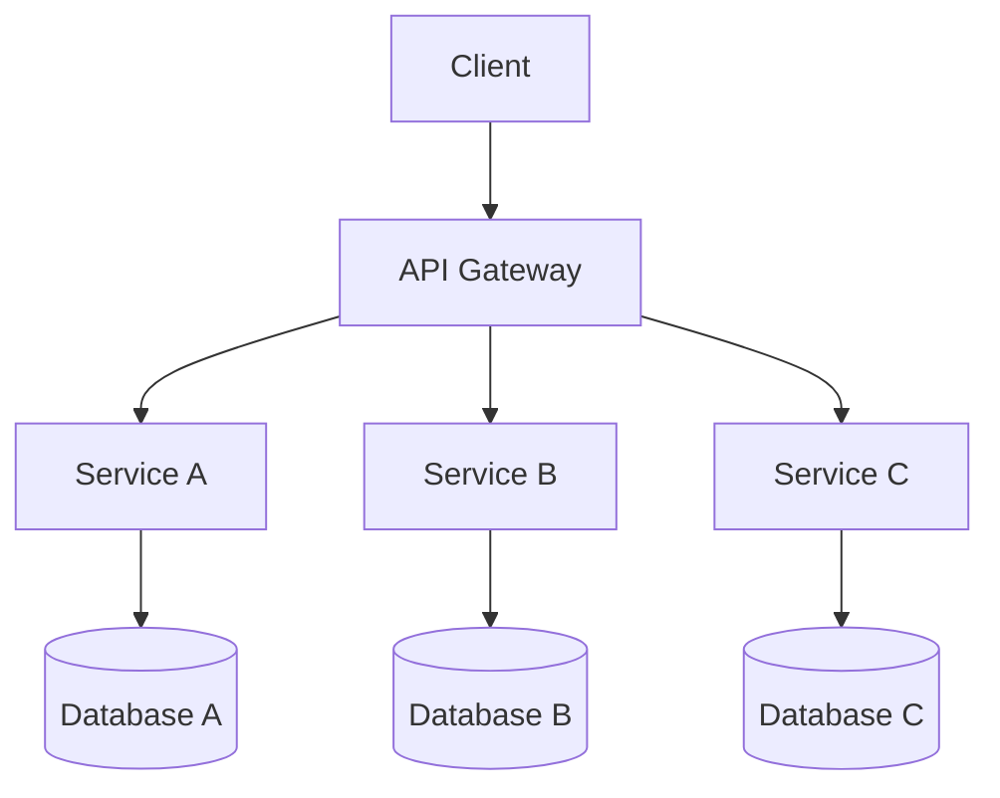

A practical guide to understanding Java memory and analysing `.hprof` heap dumps for security work.

> [!warning]
>  Scope and authorization Heap dumps routinely contain passwords, tokens, session IDs and personal data. Only analyse dumps from systems you own or are explicitly authorized to test. Treat every dump as sensitive material: store it encrypted, restrict access, redact secrets in reports, and never paste recovered values into public sites or shared documents.

> [!info] Conventions used in this note
> 
> - `<PLACEHOLDER>` marks values you must supply or that are redacted.
> - A string match is a **clue, not proof**. Always move from keyword → object → context.
> - OQL queries are version-sensitive. Verify them on your MAT version (see [OQL](https://claude.ai/chat/3b166180-6738-4e71-8795-8572d51babb0#oql-object-query-language)).

## What is the JVM?

The Java Virtual Machine (JVM) is the runtime that executes Java bytecode. When a Java application starts, the JVM loads classes, creates objects, executes code, and manages memory.

A typical application might use Spring Boot for its web API, Tomcat to handle HTTP requests, and H2 as an in-memory database. All of these run inside the JVM process.

![[Pasted image 20261013083443.png]]

At runtime the application creates objects representing HTTP requests, database connections, user accounts, configuration properties and authentication sessions. **A heap dump captures many of these objects at a single point in time.**

## How Java memory is organized

To understand heap dumps properly, you need to understand how a Java application uses memory while it runs. The JVM does not store everything in one place. It uses several memory areas, each with a different purpose, lifetime, and relationship to `garbage collection`.

1. Heap
2. Thread stacks
3. Metaspace
4. Code cache
5. Native memory

![[Pasted image 20261013085321.png]]

> [!important] Key takeaway 
> A heap dump primarily describes **heap objects**. It is _not_ a complete snapshot of every memory area the JVM process uses.

### The heap

The heap is the main area where Java objects and arrays are allocated. It is shared across all threads in the JVM.

```java
class User {
    String username;
    String email;
}

User user = new User();
user.username = "doe";
user.email = "doe@example.test";
```

The local variable `user` is part of the method's execution state (the stack). The `User` instance, and the `String` objects it references, are heap objects.

**Typical heap contents**

- Instances of application classes
- Strings, collections and arrays
- Objects created by Spring, Tomcat, JDBC drivers and other libraries
- Configuration objects
- Cached records and application data
- Objects involved in HTTP requests and authentication

This is why the heap matters for security: if a secret is represented by a Java object and that object is still in the captured heap, the dump may expose it.

**Is the heap shared by all threads?** Yes. Threads in the same JVM can access shared heap objects if they hold references to them. Thread A (an admin request) and Thread B (a passenger lookup) may both use the same Spring service or configuration object while keeping separate stacks. The heap is useful for investigating application-wide objects, stacks explain what individual threads are doing.

### Garbage collection and reachability

Java frees most heap memory automatically through garbage collection (GC). An object becomes eligible for collection when it is no longer **reachable** from a GC root.

```java
User user = new User();
user = null;   // removes this reference only
```

Setting `user` to `null` removes one reference. It does not guarantee the object is collected immediately: another reference may exist, and collection timing is not deterministic.

```java
class ApplicationCache {
    static User cachedUser = new User();
}
```

A static field can keep an object reachable for as long as the class and reference stay live. Finishing a request does not guarantee the object's removal.

**Questions to ask during analysis**

- What object contains the data?
- What references point to it?
- Is it still reachable?
- Could a cache, static field, session or long-lived service be retaining it?

MAT's **Paths to GC Roots** helps answer the last two.

> [!note] 
> A secret can stay in memory long after the operation that used it has finished, if any object still references it. Conversely, objects collected before the dump was taken will generally be absent.

### Thread stacks

A thread is an execution path within a process. Web servers use many threads to handle requests concurrently. **Each thread has its own stack; the heap is shared.**

**Stack frame:** When a method is called, the thread's execution state includes a frame for that method. The frame tracks information needed to execute the method, such as local variables, intermediate computation state, and the return point.

```java
public User findUser(String username) {
    User user = userRepository.findByUsername(username);
    return user;
}
```

While this runs, its frame conceptually holds the `username` parameter and the local `user` variable. Real representation depends on the JVM and compiler optimizations; not every source-level variable is inspectable at every moment.
#### Stack vs Heap

|Characteristic|Stack|Heap|
|---|---|---|
|Organization|Per thread|Shared within the JVM|
|Main purpose|Method execution state|Objects and arrays|
|Typical contents|Frames, locals, intermediate state|User objects, strings, collections|
|Lifetime|Frames pushed and popped as methods run|Objects live while reachable, subject to JVM behavior|
|Troubleshooting use|Thread state, execution problems|Memory usage, retention, application data|
|In an ordinary heap dump?|Not as a complete stack snapshot|Yes, the primary target|

> [!note]
>  Common oversimplification "Primitives live on the stack, objects live on the heap" is too simple. Objects are generally heap-allocated, while primitives and references can appear in different places depending on whether they are fields, locals, static fields or optimized execution state.

**Why stacks matter for security.** In `validateToken(String token)`, the frame may hold a reference to the token string. The string object itself is generally on the heap, so a dump may capture it, but a heap dump is **not** a reliable record of local variables or the full call stack. If you need to know what a thread was executing, take a **thread dump** (`jcmd <PID> Thread.print`) or a richer capture such as a JFR recording.

### Metaspace

Metaspace holds **class metadata** in modern HotSpot JVMs (it replaced PermGen in Java 8). Class metadata includes structural information about loaded classes, such as their names, fields, methods, and related runtime structures.

For example, when the JVM loads a class called:

```
com.example.DatabaseConfig
```


```java
class DatabaseConfig {
    String username;
    String password;
}
```

- The **class definition** (metadata) describes the type and its fields.
- Each `DatabaseConfig` **instance** contains the particular field values for that instance.

![[Pasted image 20261013094517.png]]

This shows the conceptual relationship, not a literal pointer layout. A heap dump includes class metadata needed to interpret instances, but metaspace itself is not just another set of heap objects.

**Class loaders** load classes into the JVM. Apps may use several class loader, particularly when frameworks, plugins, application servers, or dynamic class loading are involved. Classes and class loaders can stay live longer than expected, and a class loader that cannot be reclaimed contributes to **class-loader leaks**, especially when apps are redeployed repeatedly on an app server.

**Why it matters in analysis.** Class names such as `org.springframework...`, `org.apache.catalina...` or `com.zaxxer.hikari...` reveal which frameworks and libraries are present. They do **not** prove a component is vulnerable or that a feature is active. For suspected metaspace problems use JVM monitoring, class-loading diagnostics and native-memory tools rather than relying on a heap dump.

### Code cache

The JVM interprets bytecode and uses the Just-In-Time (JIT) compiler to compile frequently executed methods (hot methods) into native machine code. The **code cache** stores that compiled code.

Distinct concepts for `int add(int a, int b)`:

- **Source code** is the human-readable program.
- **Bytecode** is the JVM-level representation.
- **Machine code** may live in the code cache.
- **Objects** the method creates live on the heap.

The code cache is usually not useful for heap analysis. It matters when diagnosing JIT issues, code-cache exhaustion or compilation performance, which need JVM performance and compiler diagnostics.

### Native memory

Native memory is allocated **outside the Java heap** by the JVM itself, native libraries and OS-interacting components. Examples:

- Thread stacks and native thread resources
- Direct byte buffers
- Native libraries and memory used by JNI code
- Certain JVM internal structures and GC bookkeeping

```java
ByteBuffer buffer = ByteBuffer.allocateDirect(1024);
```

The backing storage is outside the heap, but the `ByteBuffer` wrapper is a heap object. A dump may show the wrapper without the native allocation behind it.

JNI lets Java call native C/C++ code, which can allocate or retain data outside the heap. This is one reason a process can use far more memory than the heap suggests.

```bash
ps -o pid,rss,vsz,comm -p <PID>
```

- **RSS**: resident memory currently in physical RAM.
- **VSZ**: virtual address space.
- Neither equals heap size or MAT's retained heap.

If native memory is the suspect, HotSpot **Native Memory Tracking (NMT)**, when enabled, helps investigate JVM native categories. It has prerequisites and overhead, and does not cover every native allocation.

> [!important] Native-memory takeaway
>  A heap dump cannot explain every source of JVM process memory consumption.


## Core concepts for heap-dump analysis

> [!info] Basic terms
> 
> - **Object**: an instance of a Java class.
> - **Field**: a value or reference stored in an object.
> - **Reference**: a connection from one object to another.
> - **`.hprof`**: the common heap-dump format associated with HPROF tooling. It is binary, not plain text.

### Object graphs

An object graph is the network of objects and the references connecting them. **This is the most important mental model for heap-dump analysis.** Imagine an application with these objects:
- A Spring configuration object.
- A datasource object.
- A connection pool.
- A database connection.
- A set of application records.

The configuration object may reference the datasource, the datasource may reference the connection pool, and the connection pool may reference connections.

A conceptual graph could look like this:

![[Pasted image 20261013102602.png]]

>[!Note] Why references matter.
> If you find the text `example-value` in a dump, on its own you cannot tell whether it is a password, a test fixture, an error-message fragment, a sample config value, or a real secret held by a live object. If MAT shows it is referenced by a live datasource configuration object, that is far more relevant to a credential investigation than the same text inside a library documentation string.
>  Even then, a plausible relationship does not prove the credential works; that is a separate question.

### Terminology

|Term|Meaning|
|---|---|
|Shallow heap|Memory directly occupied by an object|
|Retained heap|Memory that would become reclaimable if the object and objects it exclusively retains were unreachable|
|GC root|A JVM-recognized starting point for reachability analysis (thread references, static fields, JVM-managed references)|
|Dominator|An object that must be traversed to reach a particular object from the roots|
|Class metadata|Information describing a loaded class (name, fields)|
|Instance|A particular object created from a class|
|Reference chain|A sequence of references connecting objects|
|Histogram|A summary of objects grouped by class|
|Object graph|The network of objects and references in the dump|

####  Shallow vs Retained heap

A small Java object may reference a large array. The object itself consumes little memory (**shallow heap**), but it may keep the array in memory. If the object becomes unreachable and no other references keep the array alive, that memory may become reclaimable. The memory that would become reclaimable when an object is removed is its **retained heap**.

Retained heap is often more informative than shallow heap when investigating memory leaks. However, in security analysis, **memory size is not the same as security importance**: a tiny object holding a sensitive authentication token may matter more than a large, harmless array.

#### Dominator tree

Organizes objects by retention relationships. Great for finding what keeps large collections alive. For security, use it as a navigation aid, not a secrets report; sensitive objects need not be top dominators.

#### Paths to GC Roots

Shows a chain of references from an object to a GC root, answering `"why is this still reachable?" `For example, a string may be reachable through a configuration object, which is reachable through a datasource, which is reachable through an application singleton.

That chain can help establish the object's role in the running application. A path to a GC root does not prove that the value is sensitive or valid. It explains reachability, not security impact.

## Getting a heap dump

Know how dumps are produced. It determines what is in them and where they leak.

|Method|Command / setting|
|---|---|
|On demand (recommended)|`jcmd <PID> GC.heap_dump /path/heapdump.hprof`|
|Older tool|`jmap -dump:format=b,file=heapdump.hprof <PID>`|
|On out-of-memory|`-XX:+HeapDumpOnOutOfMemoryError -XX:HeapDumpPath=/path/`|
|Spring Boot Actuator|`GET /actuator/heapdump` **if the endpoint is exposed**|
|Thread dump (companion)|`jcmd <PID> Thread.print`|

> [!note] 
> Live vs all objects `jmap -dump:live,...` and the default `jcmd GC.heap_dump` trigger a full GC and keep only **reachable** objects. For forensic work where you want remnants of secrets that are no longer referenced, add `-all` to `jcmd GC.heap_dump` (supported on recent JDKs). Check `jcmd <PID> help GC.heap_dump` on your version.

> [!danger] Exposed heapdump endpoints
> An unauthenticated or weakly protected `/actuator/heapdump` hands an attacker the entire in-memory state of the application. This is one of the most common real-world sources of heap-dump leaks. See [[JVM Heap Dump Analysis#11. Defensive notes | Defensive notes]].


## Initial triage with command-line tools

`strings` is useful for quick triage but does not understand the HPROF object graph.

### Verify and preserve the dump

```bash
file heapdump.hprof
ls -lh heapdump.hprof
sha256sum heapdump.hprof
```

Record type, size, hash, source and collection context. A `.hprof` extension alone does not guarantee a valid or complete dump.

### Extract readable strings

```bash
# 8-bit strings (ASCII/Latin-1, UTF-8)
strings -a heapdump.hprof > heap-strings.txt

# UTF-16 strings (older JVMs store char[] as big-endian UTF-16)
strings -a -e b heapdump.hprof >> heap-strings.txt
strings -a -e l heapdump.hprof >> heap-strings.txt   # little-endian, for completeness
```

> [!note] 
> Since Java 9, compact strings store Latin-1 text as `byte[]`, so plain `strings -a` finds most of it. Dumps from older JVMs, or strings with non-Latin-1 characters, need the UTF-16 passes above.

### Why `strings` can mislead

Suppose the output contains `DB_PASSWORD`, `spring.datasource.url`, `password`. These may be configuration keys, library docs, defaults, application messages or real runtime data. A flat text search cannot tell you whether:

- `DB_PASSWORD` is only a variable _name_ or a populated value
- a string belongs to an active object or is a library constant
- a URL is in use or just a template
- a password-like string is valid or belongs to the application

**The purpose of MAT is to restore the object-level context that flat text search loses.**

> [!Note]
>  Adjacent lines in `strings` output are **not** necessarily fields of the same object. Do not conclude a password belongs to a particular database just because it appears near a JDBC URL.

### First-pass searches

```bash
# Database
grep -inE 'jdbc:|spring\.datasource|hibernate\.connection|DB_PASSWORD|DB_USERNAME' heap-strings.txt

# Connection pools and persistence
grep -inE 'HikariDataSource|HikariConfig|HikariPool|BasicDataSource|EntityManager|SessionFactory' heap-strings.txt

# Credentials
grep -inE 'password|passwd|pwd|credential|secret|api[_-]?key|token' heap-strings.txt

# Add context around a hit (3 lines before/after)
grep -in -C 3 'spring.datasource.password' heap-strings.txt
```


## Tools that speed up secrets hunting

Manual `strings` + `grep` works, but multi-GB dumps and repeated engagements justify tooling. **Use these for triage, then confirm every finding in MAT.**

|Tool|Best for|Limitation|
|---|---|---|
|`hprof-slurp`|Fast, low-memory summary of very large dumps|Overview tool, not a secrets scanner|
|`ripgrep` (`rg`)|Much faster searching of extracted strings than `grep`|Still flat text, no object context|
|`gitleaks` / `trufflehog`|Pattern and entropy detection of API keys, tokens, private keys|False positives; no object context|
|JDumpSpider|Pulling well-known Spring Boot items (datasource, env properties)|Only finds what it was written to look for|
|MAT headless (`ParseHeapDump.sh`)|Pre-building indexes and reports for large dumps|Needs RAM; analysis is still manual|

> [!note] 
> Tool flags change between versions and some are third-party projects. Run `--help` for your installed version and review any third-party tool before pointing it at sensitive data.

### Triage a large dump with `hprof-slurp`

```bash
hprof-slurp heapdump.hprof
hprof-slurp --help      # confirm options (e.g. top-N, string listing) for your version
```

Look at the top classes by instance count and size to see which frameworks and application classes are present **before** you open MAT. It parses in a streaming fashion, so it works on dumps too large to load comfortably into MAT.

### Search faster with ripgrep

```bash
rg -ai 'jdbc:|spring\.datasource|client_secret|eyJ[A-Za-z0-9_-]{10,}' heap-strings.txt
rg -ai -C 3 'Bearer ' heap-strings.txt
```

### Run a secret scanner over the extracted text

```bash
trufflehog filesystem heap-strings.txt
gitleaks detect --no-git --source . -v    # newer versions: gitleaks dir .
```

Scanners are good at recognising key formats (cloud keys, JWTs, private-key headers). Expect noise: many hits will be library constants or examples.

### Spring Boot-specific extraction

```bash
java -jar JDumpSpider.jar heapdump.hprof
```

Useful for quickly surfacing datasource settings and environment properties from Spring Boot dumps. Treat the output as leads to verify in MAT.

### Parse headless for large files

```bash
./ParseHeapDump.sh heapdump.hprof org.eclipse.mat.api:suspects org.eclipse.mat.api:overview
```

Raise `-Xmx` in `MemoryAnalyzer.ini` (or the headless script's environment) if parsing runs out of memory. Large dumps can need memory and disk comparable to or larger than the dump itself.

> [!important] 
> Tool output is a lead, not a finding A scanner hit is a string, not proof of a live credential. Trace the object, check its references in MAT, and redact values before sharing results.


## Eclipse Memory Analyzer Tool (MAT)

Eclipse MAT parses a dump and presents objects, classes, references and memory relationships in a form far easier to investigate than raw binary. Official site: [https://eclipse.dev/mat/](https://eclipse.dev/mat/).

#### Opening a dump

1. Launch MAT.
2. Open `heapdump.hprof` via _File → Open Heap Dump_.
3. Let MAT parse and index the file.
4. Review the Overview page and the reports offered.

#### Overview page

The Overview page gives you an initial summary of the heap dump and links to analysis reports. Use it to orient yourself before searching individual objects.

- How many objects and classes were parsed?
- How much heap is represented?
- Which reports are available?
- Any obvious memory anomalies?

These statistics describe the **captured heap** only.

#### Histogram

Groups objects by class, for example `java.lang.String`, `java.util.HashMap`, `java.util.ArrayList`, `com.zaxxer.hikari.HikariDataSource`. It answers:

- Which classes have the most instances?
- Which account for significant shallow heap?
- Are application-specific classes present?
- Which are worth investigating?

A high `String` count is normal and is not by itself evidence of a leak. Focus on **application-specific and configuration-related classes**, not every framework class.

#### Dominator Tree

Identifies objects that retain other objects and memory. Use it when investigating:
- Large caches.
- Unexpectedly retained collections.
- Objects responsible for a large portion of memory.
- Application structures that may lead to memory leaks. 

For security, use it as a navigation aid. Small config objects and individual strings matter even when they retain almost nothing.

#### Object Inspector

The Object Inspector allows you to examine an individual object's fields and relationships. This is where you move from seeing a class name to understanding a specific instance.

Suppose you locate a datasource-related object. You might inspect its class, fields, and referenced objects to understand whether it points to other configuration or connection-related objects.When inspecting an object, ask:

1. What class does it belong to?
2. What fields does it contain?
3. Which fields are primitives and which are references?
4. What do those references lead to?
5. Is the data application-specific or framework metadata?
6. Does the surrounding context support my interpretation?

#### Paths to GC Roots and incoming references

Use _Path to GC Roots_ (typically excluding weak/soft references) to see how an object stays reachable, and the incoming-references view to see who points at it.

```text
GC root
   ↓
Application singleton
   ↓
Configuration object
   ↓
String object
```

If the string holds a suspected credential, the chain can show it is associated with an application configuration object. Framework wrappers, caches, maps and proxies can lengthen chains; trace the objects rather than trusting names.

### OQL (Object Query Language)

MAT's OQL queries objects in a dump and is handy when the GUI becomes tedious. Learn it after you are comfortable with the Histogram and Object Inspector.

> [!warning]
>  Verify on your MAT version OQL looks like SQL but is not SQL. In particular, **`LIKE` takes a regular expression** (so use `".*foo.*"`, not `"%foo%"`). Check MAT's _Help → OQL_ documentation for your version.

#### Core patterns

```sql
-- All instances of an exact class
SELECT * FROM com.zaxxer.hikari.HikariDataSource

-- Instances of every class whose name matches a regex
SELECT * FROM ".*DataSource.*"

-- Class objects (metadata) whose name matches (tells you which classes exist)
SELECT * FROM java.lang.Class c WHERE c LIKE ".*Hikari.*"

-- Strings matching a regex (toString() converts the Java String for matching)
SELECT * FROM java.lang.String s WHERE toString(s) LIKE ".*jdbc:.*"
```

> [!note]
>`FROM OBJECTS <class>` returns the **class object itself**, not its instances. For instances, use `FROM <class>`.

A class existing in the dump does not prove instances exist; querying instances and inspecting fields does.

## Analysis playbooks

Each playbook follows the same loop: **search → find the object in MAT → follow references → assess**.

### Database connections and databases

**Typical connection stack**

![[Pasted image 20261013105313.png]]

Each layer can leave different objects or strings behind. Finding a driver does not prove a live connection; finding a pool class does not prove the app uses it.

| Concept         | Meaning                                                                           |
| --------------- | --------------------------------------------------------------------------------- |
| JDBC            | Java's standard API for relational databases                                      |
| JDBC driver     | Implements database-specific communication                                        |
| JDBC URL        | Database type plus connection destination or configuration                        |
| DataSource      | Object apps use to obtain connections                                             |
| Connection pool | Reuses connections instead of repeatedly creating them                            |
| ORM             | Object-relational mapping, Maps objects to database records (Hibernate is common) |
| Credentials     | Username, password or other auth material                                         |
| Query result    | Data returned by a query, which may remain in heap objects                        |
| Transaction     | A unit of work under transaction rules                                            |

**Recognising JDBC URLs** (often the fastest clue to the technology)

|Database|Format|
|---|---|
|PostgreSQL|`jdbc:postgresql://<DB_HOST>:<DB_PORT>/<DB_NAME>`|
|MySQL|`jdbc:mysql://<DB_HOST>:<DB_PORT>/<DB_NAME>`|
|SQL Server|`jdbc:sqlserver://<DB_HOST>:<DB_PORT>;databaseName=<DB_NAME>`|
|Oracle|`jdbc:oracle:thin:@//<DB_HOST>:<DB_PORT>/<SERVICE_NAME>`|
|H2 in-memory|`jdbc:h2:mem:<DB_NAME>`|
|H2 file|`jdbc:h2:file:<DATABASE_PATH>`|

**What to search for:** The most useful approach is to search by category rather than looking for the word `password` alone

| Category             | Example search terms                                                               |
| -------------------- | ---------------------------------------------------------------------------------- |
| JDBC URLs            | `jdbc:`, `jdbc:postgresql:`, `jdbc:mysql:`, `jdbc:h2:`                             |
| Spring configuration | `spring.datasource.url`,`spring.datasource.username`, `spring.datasource.password` |
| Connection objects   | `java.sql.Connection`, `ConnectionImpl`, `JdbcConnection`                          |
| Data sources         | `javax.sql.DataSource`, `HikariDataSource`, `BasicDataSource`                      |
| Connection pools     | `HikariPool`, `HikariConfig`, `PoolBase`                                           |
| ORM / persistence    | `EntityManager`, `SessionFactory`, `hibernate.connection.url`                      |
| Credential fields    | `password`, `username`, `user`, `secret`, `credential`                             |
| Query objects        | `PreparedStatement`, `ResultSet`, `Statement`                                      |
| Database records     | App entity classes such as `User`, `Account`, `Customer`                           |

#### In MAT

1. **Histogram:** filter for `DataSource`, `Connection`, `HikariConfig`, `HikariDataSource`, driver-specific connections, ORM sessions. Instance counts help prioritise but do not show an object is active or sensitive.
2. **Object Inspector:** open a relevant instance and look for fields such as `jdbcUrl`, `username`, `password`, `dataSource`, `connection`, `poolName`, `driverClassName` (names vary by library and version).
3. **Follow references** from the config object to the datasource, pool and connections.

```text
Spring application context
 └── DataSource bean
      └── Hikari connection pool
           └── JDBC connection
```

This is illustrative, not guaranteed. A reachable object may be active, cached, idle or retained for another reason.

4. **Inspect data objects** (`com.example.app.User`, `Account`, `Customer`, `Session`) for usernames, emails, tokens, session IDs and query results. An entity instance is not necessarily a complete record: it may hold only selected columns, partial relationships, stale or transformed values.

##### OQL

```sql
-- Which datasource-related classes exist?
SELECT * FROM java.lang.Class c WHERE c LIKE ".*DataSource.*"

-- Instances of datasource classes
SELECT * FROM ".*DataSource.*"

-- Hikari classes (names such as HikariDataSource, HikariConfig, HikariPool)
SELECT * FROM java.lang.Class c WHERE c LIKE ".*Hikari.*"

-- Hikari instances, once the exact class name is confirmed in the Histogram
SELECT * FROM com.zaxxer.hikari.HikariDataSource

-- H2-related classes (refine by driver once known)
SELECT * FROM java.lang.Class c WHERE c LIKE ".*h2.*"

-- Spring datasource properties classes
SELECT * FROM java.lang.Class c WHERE c LIKE ".*DataSourceProperties.*"

-- JDBC URL strings
SELECT * FROM java.lang.String s WHERE toString(s) LIKE "jdbc:.*"
SELECT * FROM java.lang.String s WHERE toString(s) LIKE ".*jdbc:h2:.*"

-- Property-name strings found during triage
SELECT * FROM java.lang.String s WHERE toString(s) LIKE ".*spring\\.datasource.*"
SELECT * FROM java.lang.String s WHERE toString(s) LIKE ".*DB_PASSWORD.*"
```

Class-metadata queries show which classes exist, not that instances do. String queries find matching strings; they do not prove the property is active or that a secret value sits alongside it.

**Security implications by database type**

|Type|Investigate|
|---|---|
|**Remote** (PostgreSQL, MySQL, Oracle, SQL Server)|Internal hostnames and ports; database names and usernames; TLS configuration; credential exposure; whether sensitive data or query results are retained in memory. A remote-looking URL does not prove public accessibility.|
|**In-memory** (H2 etc.)|Database mode and configuration; whether user records or credentials are held in memory; sensitive entity objects or results; whether it is temporary or persisted. In-memory is not automatically secure: data can still leak via heap dumps, logs, debug consoles.|
|**File-based**|Database paths; file permissions and ownership (where host access is authorized); whether paths reveal internal directory structure; whether credentials or data appear in the heap independently of the file. A path in a dump does not prove the file exists or is accessible.|

### Secrets and credentials

A **secret** is sensitive information only authorized people or systems should access. A **credential** is information used to establish identity or prove authorization.

|Category|Examples|Potential impact if exposed|
|---|---|---|
|User credentials|Passwords, password hashes, PINs|Account compromise, depending on data and protections|
|API credentials|API keys, client secrets|Unauthorized API use within the key's permissions|
|Authentication tokens|JWTs, OAuth access/refresh tokens|Impersonation until expiry or revocation|
|Session credentials|Session IDs, cookies|Session hijacking if valid and reusable|
|Cryptographic keys|Private, symmetric, signing keys|Decryption, forgery or impersonation|
|Cloud credentials|Access keys, service-account tokens|Access to cloud resources within permissions|
|Database credentials|DB usernames and passwords|Database access if valid and reachable|
|Application secrets|Signing secrets, webhook secrets, passphrases|Forgery, decryption, unauthorized integration access|

**Search by category**

```bash
# Passwords and credential configuration
grep -inE 'password|passwd|pwd|credential|client_secret|DB_PASSWORD' heap-strings.txt

# API keys and access tokens
grep -inE 'api[_-]?key|access_token|refresh_token|client_id|client_secret|Bearer ' heap-strings.txt

# JWT-related indicators
grep -inE 'jwt|JsonWebToken|Authorization|Bearer|eyJ' heap-strings.txt

# Cryptographic material
grep -inE 'PrivateKey|SecretKey|KeyStore|KeyManager|TrustManager|SSLContext|BEGIN .*PRIVATE KEY' heap-strings.txt

# Cloud and service credentials
grep -inE 'AWS_ACCESS_KEY_ID|AWS_SECRET_ACCESS_KEY|GOOGLE_APPLICATION_CREDENTIALS|service.account|client_secret' heap-strings.txt

# Context around a match
grep -in -C 4 'client_secret' heap-strings.txt
```

These are intentionally broad. A match may be a property name, class name, documentation string or an actual value, and adjacent output is not proof of same-object membership.

**How the secret is represented determines how you analyse it**

|Representation|Example|Approach|
|---|---|---|
|Java `String`|`"<REDACTED_TOKEN>"`|Search strings, inspect incoming references|
|Character array|`char[]`|Inspect array contents and references in MAT|
|Byte array|`byte[]`|Inspect contents and the owning object's fields|
|Configuration object|`AuthConfig`|Inspect fields and relationships|
|Token object|Library-specific JWT class|Inspect claims, encoded values, references|
|Key object|`SecretKeySpec`, `PrivateKey` impl|Identify algorithm and purpose without unnecessarily exposing key material|
|Wrapped secret|Secret-manager or provider object|Follow references to see whether the secret is retained locally|

**Strings vs arrays.** Java `String`s are immutable: replacing a reference does not guarantee the old value disappears from memory. Character/byte arrays can be overwritten by application code, but that does not guarantee no copies exist elsewhere: a password may pass through an input buffer, a `String`, a request object and a library credential object, and clearing one does not clear them all. Also, `String`'s internal representation varies by Java version, so do not assume every string is backed by a `char[]`.

#### In MAT

- **Histogram targets:** `java.lang.String`, `[B` (byte arrays), `[C` (char arrays), `java.util.Properties`, `javax.crypto.spec.SecretKeySpec`, `java.security.PrivateKey` implementations, framework token and credential classes.
- **Object Inspector:** for a hypothetical config object, you might see `apiKey = <REDACTED>`, `clientId = <CLIENT_ID>`, `clientSecret = <REDACTED>`.
- **Incoming references:** find which objects reference the candidate secret.

```text
Application configuration
 └── Authentication provider
      └── Client credentials
           └── Secret value
```

- **Paths to GC Roots:** explains why it is retained (singleton bean, static field, long-lived cache, HTTP client). This explains retention, **not validity**: a reachable token may be expired, and an important-looking object may no longer be used.
- **Dominator Tree:** poor as a secret detector. A token may occupy almost no memory yet matter greatly; prioritise sensitivity and context.

### User sessions and authentication

**Authentication** answers _who are you?_ Common methods: username/password, session cookies, JWTs, OAuth 2.0 tokens, client certificates, API keys, SSO. After authenticating, an app may retain identity in memory:

```text
Authentication
├── principal: <USER_ID>
├── authenticated: true
├── authorities
│   ├── ROLE_USER
│   └── ROLE_ADMIN
└── credentials: <REDACTED>
```

Finding such an object does not prove the user has an active session or that credentials remain valid.

**Authorization** answers _what are you allowed to do?_

|User|Role|Example permissions|
|---|---|---|
|`<USER_A>`|`ROLE_USER`|Read personal profile|
|`<USER_B>`|`ROLE_SUPPORT`|View support records|
|`<USER_C>`|`ROLE_ADMIN`|Manage application accounts|

Key questions: which identity is the role tied to, is it actually assigned, does the app use it for decisions, and is the state current or merely cached?

**How sessions work**

1. The user submits login credentials.
2. The server authenticates the user.
3. The server creates or associates a session with the identity.
4. The client receives a session identifier, often as a cookie (`Cookie: JSESSIONID=<SESSION_ID>`).
5. Later requests present that identifier.
6. The server uses it to locate session state.

**What may be retained:** session objects and IDs, authenticated user objects, login/creation/last-access timestamps, session attributes, role and permission collections, CSRF tokens, authentication objects, references to requests or security contexts. Not all apps store all of these; a session may live in an external Redis while the app keeps only an ID or temporary copy.

**Session identifier vs session object**

```text
Session identifier:  <SESSION_ID>

Session
├── id: <SESSION_ID>
├── creationTime: <TIMESTAMP>
├── lastAccessedTime: <TIMESTAMP>
└── attributes
    └── user: <USER_OBJECT>
```

The layout is conceptual. Finding an ID does not prove the session object exists, and finding a session object does not prove a client holds the ID. A valid, reusable identifier is security-sensitive because it could allow impersonation.

**Investigation priorities**

|Priority|Area|Objective|
|---|---|---|
|1|Session identifiers and objects|Identify session data and what it references|
|2|Authentication tokens|Find candidate JWTs, bearer tokens, other auth material|
|3|Authenticated users and principals|Identify user objects and identities in memory|
|4|Roles and authorization state|Relate identities to roles and permissions|
|5|Session lifecycle and security context|Understand state retention and related controls|

These overlap: a Spring Security `Authentication` may hold a principal and authorities and be referenced from a request-scoped security context.

#### Command-line triage

```bash
# Session indicators
grep -inE 'JSESSIONID|HttpSession|sessionId|session_id|session-id|sessionToken' heap-strings.txt
grep -in -C 3 'JSESSIONID' heap-strings.txt

# Authentication (Spring Security and similar)
grep -inE 'Authentication|SecurityContext|SecurityContextHolder|Principal|UserDetails|authenticated' heap-strings.txt

# Tokens
grep -inE 'Authorization|Bearer|access_token|refresh_token|id_token|JWT|JsonWebToken' heap-strings.txt

# User identity (may expose personal data even without reusable credentials)
grep -inE 'UserDetails|username|userId|user_id|principal|accountId|email' heap-strings.txt

# Roles and permissions
grep -inE 'ROLE_ADMIN|ROLE_USER|ROLE_SUPERUSER|GrantedAuthority|authorities|permissions|accessControl' heap-strings.txt
```

An `Authorization: Bearer <ACCESS_TOKEN>` header shows the format; real tokens are sensitive and must not be pasted into public sites or shared reports.

**Interpreting what you found**

|Finding|Possible meaning|What to verify|
|---|---|---|
|`JSESSIONID`|Cookie name or framework constant|Whether a real identifier or session object exists|
|`HttpSession`|Session API or related object|Whether session instances are present|
|`SecurityContext`|Auth context type|Whether it holds authentication state|
|`ROLE_ADMIN`|Role name or app constant|Whether assigned to a specific principal|
|`Authorization: Bearer`|Header indicator|Whether a real token exists and what references it|
|`UserDetails`|Spring Security user abstraction|Whether instances hold identity or authority data|
|`authenticated=true`|Possible auth-state indicator|Which object holds it and what the framework means by it|
|`access_token`|Token-related property or value|Whether it is a real token and who owns it|

> [!important] 
> A reliable analysis moves from a keyword to an actual object, then establishes the object's context.

#### In MAT

Search the Histogram for likely classes (they depend on server, framework versions and app design; absence does not prove absence of sessions):

```text
org.apache.catalina.session.StandardSession
org.springframework.security.core.context.SecurityContextImpl
org.springframework.security.authentication.UsernamePasswordAuthenticationToken
org.springframework.security.core.userdetails.User
org.springframework.security.core.authority.SimpleGrantedAuthority
```

- **Session objects** (for example Tomcat `StandardSession`): look at identifier, creation and last-access time, attributes, validity state, owning manager. Attributes may reference user objects or auth state.

```text
StandardSession
├── id: <REDACTED_SESSION_ID>
├── creationTime / lastAccessedTime
└── attributes
    ├── user: <USER_OBJECT>
    └── securityContext: <SECURITY_CONTEXT>
```

##### Security contexts
 
 Spring Security commonly uses the `SecurityContext` abstraction to hold authentication information. A possible implementation is:

```
org.springframework.security.core.context.SecurityContextImpl
```

Inspect the instance for an authentication reference. Questions to investigate:

1. Is there an actual security context instance?
2. Does it reference an authentication object?
3. Does that object reference a principal?
4. Does the principal contain identity information?
5. Are authorities or roles associated with the authentication object?
6. Is the context retained by a session, request, singleton, or another component?

A security context instance may be retained without representing a currently active user session. Interpret the references and application lifecycle together.

##### Principals and users

In Spring Security, a principal represents the identity associated with an authentication.A common implementation is:

```
org.springframework.security.core.userdetails.User
```

Other applications may use a custom principal class, such as:

```
com.example.security.CustomPrincipal
```

Inspect fields that may represent:

- Username or user ID.
- Account status.
- Granted authorities.
- Tenant or organization ID.
- References to a domain user object.
- **Authorities** (`SimpleGrantedAuthority` with `authority: ROLE_ADMIN`): to show a principal _has_ an authority, follow references from the authentication object to its authority collection.

##### OQL

```sql
-- Class discovery (broad; refine with real class names from your dump)
SELECT * FROM java.lang.Class c WHERE c LIKE ".*Session.*"
SELECT * FROM java.lang.Class c WHERE c LIKE ".*StandardSession.*"
SELECT * FROM java.lang.Class c WHERE c LIKE ".*SecurityContext.*"
SELECT * FROM java.lang.Class c WHERE c LIKE ".*Authentication.*"
SELECT * FROM java.lang.Class c WHERE c LIKE ".*(User|Principal).*"
SELECT * FROM java.lang.Class c WHERE c LIKE ".*GrantedAuthority.*"

-- Instances (once the exact class is confirmed)
SELECT * FROM org.apache.catalina.session.StandardSession

-- Strings (indicators only)
SELECT * FROM java.lang.String s WHERE toString(s) LIKE ".*(JSESSIONID|sessionId|session_id).*"
SELECT * FROM java.lang.String s WHERE toString(s) LIKE "ROLE_.*"
SELECT * FROM java.lang.String s WHERE toString(s) LIKE ".*Bearer .*"
SELECT * FROM java.lang.String s WHERE toString(s) LIKE "eyJ.*"
```

- `ROLE_` strings are indicators; establish assignments through real authentication and authority objects.
- The Bearer query may miss tokens stored as separate header-name/value objects or non-string forms.
- The `eyJ` query is a basic JWT heuristic. It does not validate format, signature, issuer, audience, expiry or usability.

> [!warning] 
> OQL limitation OQL finds classes and strings. It does not reconstruct relationships such as `Session → SecurityContext → Authentication → Principal → Authorities`. Use MAT's object inspection and reference navigation for that; it is the critical part of the investigation.

### API configuration and internal architecture

Modern applications rarely operate as a single component. A Java web application may communicate with multiple internal services, external APIs, authentication providers, and data stores.

For example, consider a hypothetical airport application:



Each service may have its own URL, auth mechanism, configuration and database. A dump can reveal parts of this because the app may retain configuration objects, URL strings, HTTP clients, request objects, headers and service credentials.

**Key terms**

- **API endpoint:**  is a network-accessible interface through which a client interacts with an application or service, for example `https://<API_HOST>/api/v1/books`.

|Component|Meaning|
|---|---|
|`https://`|Communication scheme|
|`<API_HOST>`|Hostname or IP address|
|`/api/v1`|API path prefix|
|`/books`|Resource or operation path|

Endpoints may accept `GET`, `POST`, `PUT`, `DELETE`, etc.

- **Upstream service:** a service the app sends requests to (for example `https://<SERVICE_A>/api/libraries`, `https://<SERVICE_B>/api/books`, `https://<AUTH_SERVICE>/oauth/token`). These may appear in config objects, HTTP clients or environment-derived properties. A discovered internal hostname helps map trust boundaries, it does not prove the host resolves, the service runs, or that you can reach it.

Consequently, API configuration analysis overlaps with secrets analysis. Here, the emphasis is on **which service uses the credential, where it sends requests, and how the authentication mechanism fits into the architecture**.

**Investigation priorities**

|Priority|Area|Objective|
|---|---|---|
|1|Internal endpoints and upstream URLs|Identify service destinations and API paths|
|2|HTTP clients|Find objects responsible for outbound communication|
|3|Service configuration|Associate URLs with config objects and service names|
|4|Service authentication|Identify mechanisms and associated credentials|
|5|Request and response data|See whether sensitive data is retained in memory|
|6|Routing and trust boundaries|Understand connections and security assumptions|

#### Command-line triage

```bash
# URLs
grep -inE 'https?://' heap-strings.txt

# Internal hostnames and private ranges (heuristic; misses other formats)
grep -inE 'localhost|127\.0\.0\.1|10\.[0-9]+\.[0-9]+\.[0-9]+|192\.168\.[0-9]+\.[0-9]+|172\.(1[6-9]|2[0-9]|3[01])\.' heap-strings.txt

# Service-discovery and naming terms
grep -inE 'upstream|serviceUrl|baseUrl|base-uri|internalHost|serviceName|discovery|gateway' heap-strings.txt

# API paths
grep -inE '/api/|/v1/|/v2/|/internal/|/admin/|/health|/actuator|/oauth/' heap-strings.txt
# Also useful: /graphql /openapi /swagger /api-docs /auth /token /authorize

# Domain-specific service names (illustrative airport app: replace with names found in recon)
grep -inE 'flight|boarding|passenger|manifest|gate|terminal|reservation' heap-strings.txt

# HTTP client libraries
grep -inE 'RestTemplate|WebClient|WebClientBuilder|HttpClient|HttpURLConnection|OkHttpClient|FeignClient|WebTarget' heap-strings.txt

# Authentication indicators
grep -inE 'Authorization|Bearer |Basic |client_id|client_secret|access_token|refresh_token|api[_-]?key' heap-strings.txt
```

For each interesting URL record: scheme, host/IP, port, path, query parameters, and nearby service or configuration identifiers.

> [!warning] 
> A URL may come from a library, test fixture, documentation or unused configuration. Establish its relationship to an actual application object before treating it as an active destination. A flat string search cannot reliably associate a service name with a URL.

**HTTP client libraries**

|Technology|Typical purpose|
|---|---|
|Spring `RestTemplate`|Synchronous HTTP requests|
|Spring `WebClient`|Reactive, nonblocking requests|
|Java `HttpClient`|Standard Java client|
|Apache HttpClient|HTTP transport and connection management|
|OkHttp|HTTP client library|
|OpenFeign|Declarative HTTP clients|
|JAX-RS client APIs|Client-side REST|

**Why HTTP client analysis matters**

Suppose you find a URL in the dump:

```
http://<INTERNAL_SERVICE_HOST>:<PORT>/api/v1/data
```

By itself, this is a string.

Now suppose MAT shows that the string is referenced by an actual HTTP client configuration object, which is referenced by a service client bean. That establishes a much stronger relationship between the URL and the application's configuration.

It still does not prove that a request was sent successfully, but it helps identify the intended communication path.

##### API configuration objects

Frameworks commonly load configuration into Java objects during startup. A configuration object might conceptually contain:

```
ServiceConfig
├── serviceName: <SERVICE_NAME>
├── baseUrl: <SERVICE_URL>
├── connectTimeout: <TIMEOUT>
├── authenticationType: <AUTH_TYPE>
└── credentials: <CREDENTIAL_CONFIG>
```

In a real application, the values may instead be distributed across several objects, environment properties, or external configuration systems.


**Spring Boot property names to look for**

```text
spring.application.name
server.port
spring.security.oauth2.client.registration
spring.security.oauth2.client.provider
services.flight.base-url        (custom)
services.boarding.base-url      (custom)
services.auth.token-url         (custom)
```

Configuration may be strings, `Properties` objects, environment abstractions or custom classes.

##### Environment variables and system properties

Applications sometimes derive service configuration from environment variables or Java system properties. Examples include:

```
FLIGHT_SERVICE_URL=<SERVICE_URL>
AUTH_SERVICE_URL=<AUTH_URL>
API_TOKEN=<REDACTED>
```


If a heap dump contains environment-derived values, inspect their context. Do not assume every environment variable is copied into the heap, or that every matching string came from the environment.

#### In MAT

Command-line searches give leads; MAT shows whether values belong to real configuration and client objects.

- **Histogram:** look for classes such as `org.springframework.web.client.RestTemplate`, `org.springframework.web.reactive.function.client.WebClient`, `java.net.http.HttpClient`, `org.apache.hc.client5.http.impl.classic.CloseableHttpClient`, `okhttp3.OkHttpClient`, `java.util.Properties`.
- **Inspect client instances:** fields and referenced objects may reveal the request factory or transport, client configuration, connection manager, interceptors/filters, proxy and TLS configuration, default headers, base URL or destination settings. Declarative clients may keep endpoint info in separate proxy or configuration objects.
- **Follow references to configuration:**

```text
Application Context
 └── Flight Service
      └── FlightServiceClient
           └── Client Configuration
                └── Base URL
```

The actual object relationship is the important evidence. Check whether the client is referenced by an application component (Spring bean or service object).

- **Request and response objects:** apps may retain these temporarily. Potentially sensitive: authorization headers, cookies, query parameters, request and response bodies, user identifiers, internal service responses.

##### OQL

```sql
-- URL strings (expect docs links and library defaults)
SELECT * FROM java.lang.String s WHERE toString(s) LIKE "https?://.*"

-- Strings resembling internal hostnames (broad; many false positives)
SELECT * FROM java.lang.String s WHERE toString(s) LIKE ".*(localhost|internal|upstream).*"

-- HTTP client class metadata
SELECT * FROM java.lang.Class c WHERE c.@name LIKE ".*(HttpClient|RestTemplate|WebClient|OkHttpClient).*"

-- Service configuration classes (intentionally broad; refine by package)
SELECT * FROM java.lang.Class c WHERE c.@name LIKE ".*(Config|Properties).*"

-- Authentication-related strings (does not prove a client uses them)
SELECT * FROM java.lang.String s WHERE toString(s) LIKE ".*(Authorization|Bearer |client_secret|access_token).*"

-- Routing-related strings (regex behaviour varies by MAT version)
SELECT * FROM java.lang.String s WHERE toString(s) LIKE ".*/(api|internal|oauth)/.*"
```

## Suggested investigation workflow

1. **Validate and preserve the dump.** Record hash, size, source and collection context.
2. **Identify the technology.** Search for JDBC prefixes, driver names, database libraries and framework configuration keys (use `hprof-slurp` for a fast overview of large dumps).
3. **Locate connection objects.** Use MAT's Histogram and inspect relevant instances.
4. **Establish relationships.** Follow references between config objects, data sources, pools and connections.
5. **Inspect potentially sensitive data.** Determine whether actual credential values, tokens or records are present.
6. **Assess impact carefully.** Separate confirmed disclosure from inferred capability; do not claim access or exploitation without evidence.
7. **Document and remediate.** Redact secrets, report evidence, restrict dump access, and review why sensitive data was retained or exposed.

## Reporting and handling findings

- **Redact** secret values in reports (`<REDACTED>`); show only enough to identify the finding (for example the first and last few characters, or a hash).
- **Record evidence:** class name, field path, reference chain from MAT, dump hash and collection method.
- **Separate** _confirmed exposure_ ("value present in object X reachable from Y") from _inferred impact_ ("could permit database access if the credential is valid and reachable").
- **Do not test validity** of recovered credentials unless your authorization explicitly covers it.
- **Store dumps encrypted**, limit who can read them, and delete them when the engagement ends.


## Defensive notes

If you are on the blue-team or developer side, these controls reduce the value of a leaked dump:

- **Lock down heap-dump access:** disable or authenticate `/actuator/heapdump` (and restrict the whole Actuator surface); keep it off the public network.
- **Protect dump files:** restrict filesystem permissions on `HeapDumpPath`, encrypt at rest, and set short retention.
- **Keep secrets out of long-lived objects:** prefer a secrets manager and short-lived tokens; avoid storing secrets in static fields and long-lived caches; clear `char[]`/`byte[]` credential buffers where practical (knowing copies may still exist).
- **Reduce blast radius:** least-privilege database and API credentials, rotation after any suspected exposure, network segmentation so leaked internal hostnames are not directly reachable.
- **Treat dumps as sensitive data** in incident handling: a dump shared with a vendor or posted to a ticket is a data disclosure.

## Conclusion

Heap dump analysis is a valuable cybersecurity skill because it exposes an application's internal state while it was running. By examining memory, an analyst can uncover exposed secrets, authentication artifacts, database configurations, internal services and other sensitive information that may not be visible through normal interaction.

A successful investigation takes more than keyword searches. It means understanding the JVM, examining object relationships, tracing references and validating findings against evidence. Combining fast command-line and scanner tooling with Eclipse MAT makes it easier to find meaningful artifacts and judge their real security impact.

The goal is to turn raw memory data into actionable findings while keeping accuracy high, protecting sensitive information, and clearly separating confirmed vulnerabilities from unverified possibilities.
